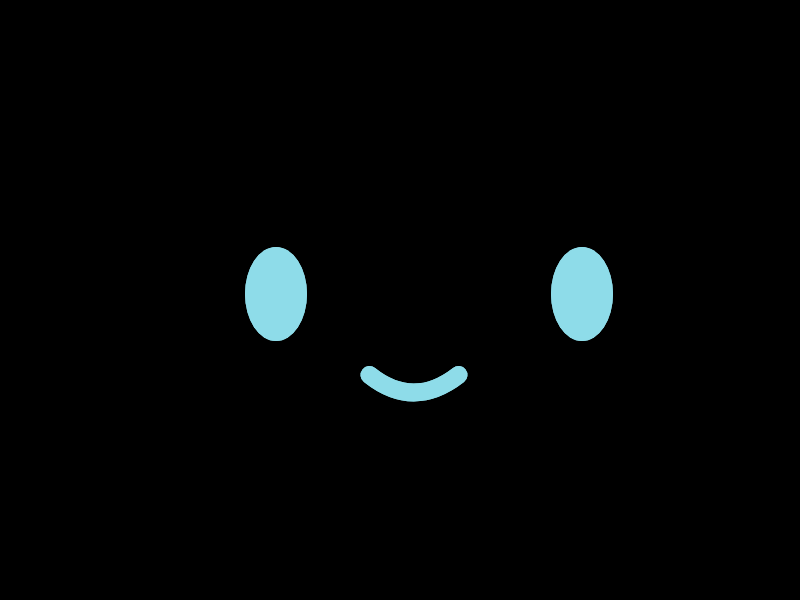
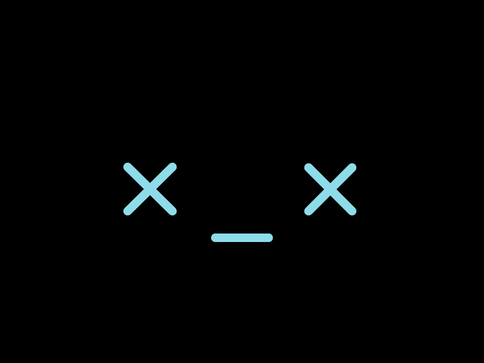
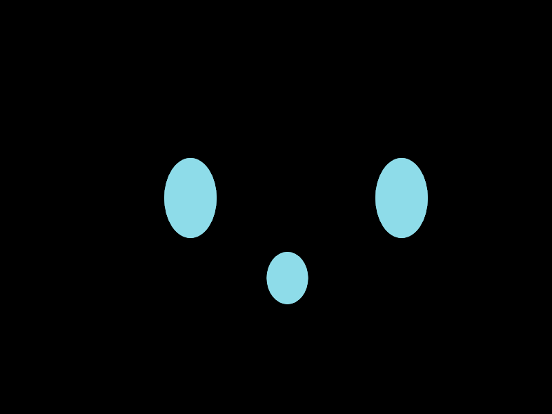
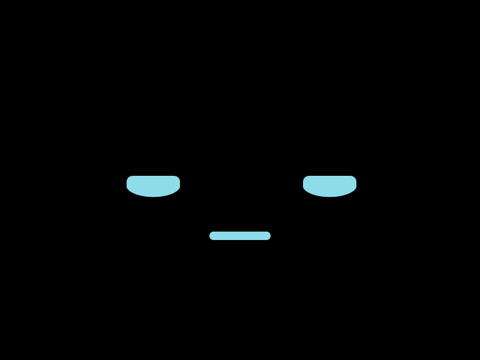
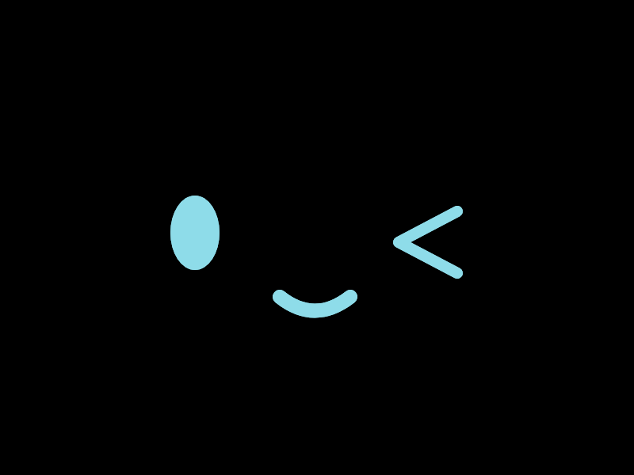
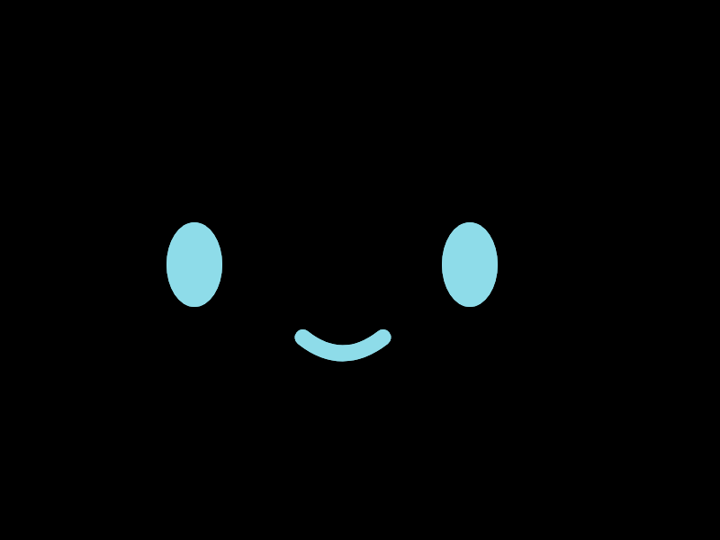

# Rapport de tests BDD — 2026-11-18 21:39

*20 scénarios : 20 OK, 0 KO.*

## Clignement des yeux — Clignement régulier sur 30 secondes — OK

## Cycle de sommeil — Endormissement et réveil — OK

## Expressions du visage — Emotion inconnue ignorée (nimportequoi) — OK

## Expressions du visage — Toutes les expressions (dead) — OK

## Expressions du visage — Toutes les expressions (dizzy) — OK

## Expressions du visage — Toutes les expressions (happy) — OK

## Expressions du visage — Toutes les expressions (laugh) — OK

## Expressions du visage — Toutes les expressions (love) — OK

## Expressions du visage — Toutes les expressions (mean) — OK

## Expressions du visage — Toutes les expressions (neutral) — OK

## Expressions du visage — Toutes les expressions (shocked) — OK

## Expressions du visage — Toutes les expressions (sleep) — OK

## Expressions du visage — Toutes les expressions (thinking) — OK

## Expressions du visage — Toutes les expressions (tired) — OK

## Expressions du visage — Toutes les expressions (wink) — OK

## Quitter sans clavier — Appui court ne quitte pas — OK

## Quitter sans clavier — Appui hors du coin ne quitte pas — OK

## Quitter sans clavier — Appui long dans le coin quitte — OK

## Quitter sans clavier — Un appui hors zone annule l'appui précédent — OK

## Regard de surveillance — Saccades régulières sur 30 secondes — OK

