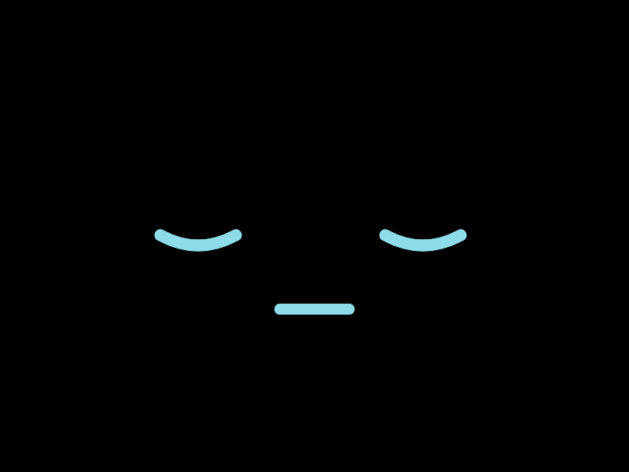
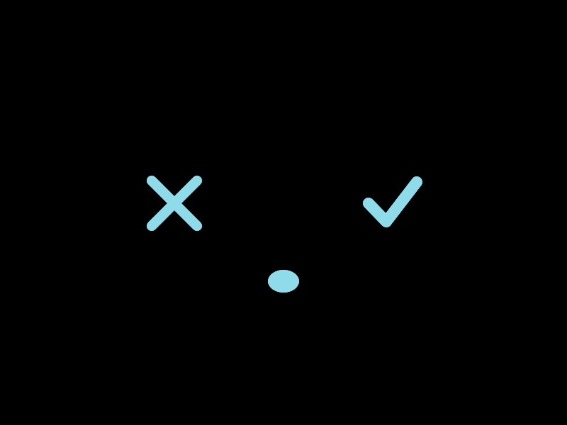
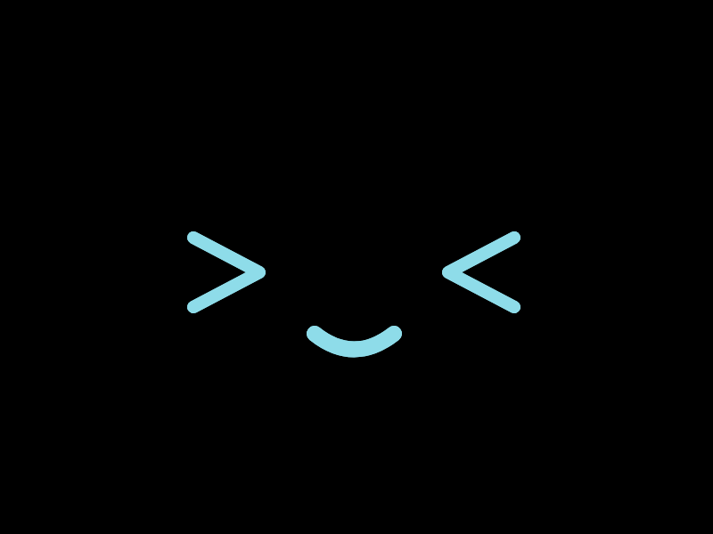
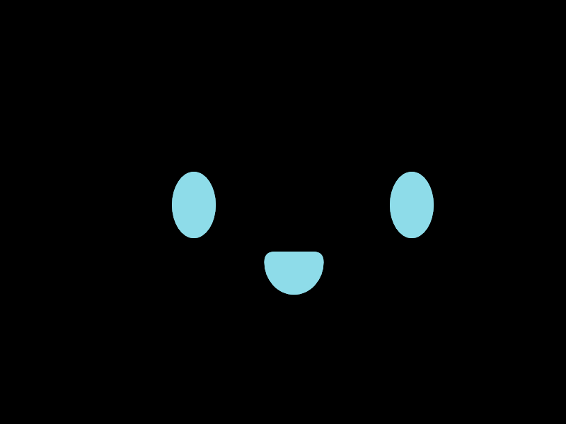
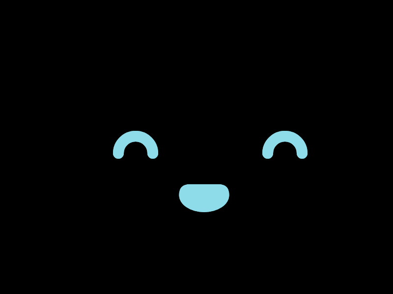
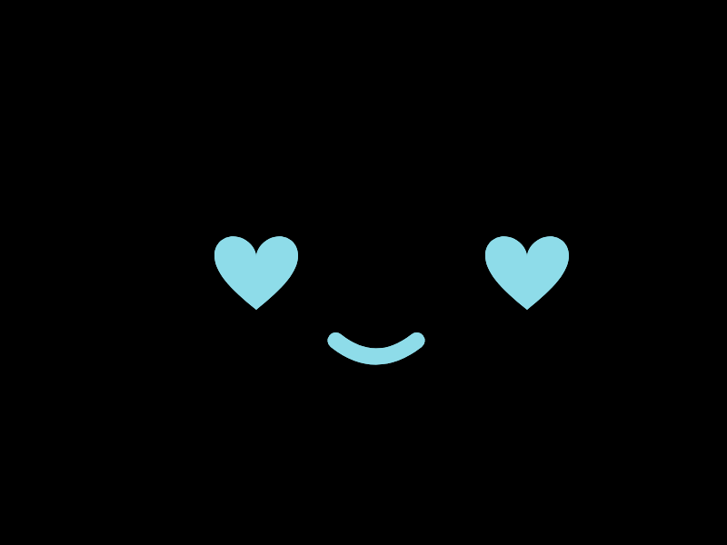
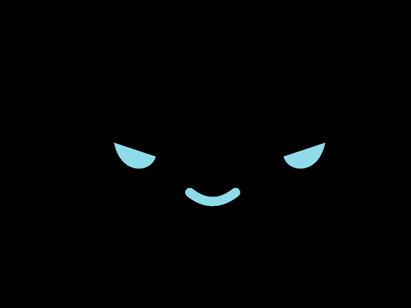
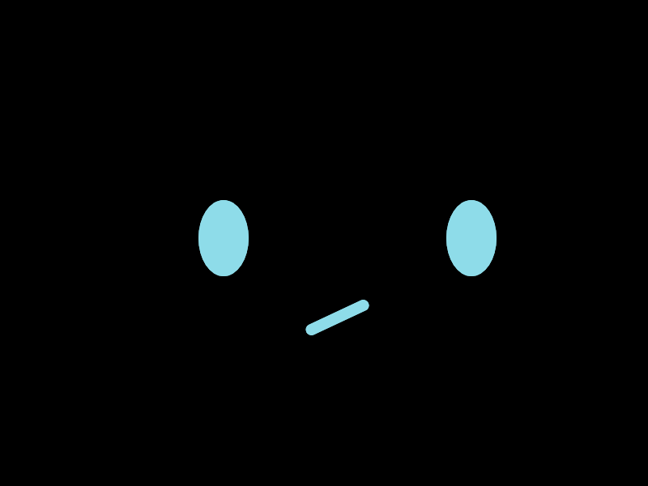

# Rapport de tests BDD — 2026-11-23 00:16

*61 scénarios : 61 OK, 0 KO.*

## Clignement des yeux — Clignement régulier sur 30 secondes — OK

## Cycle de sommeil — Endormissement automatique par inactivité — OK

## Cycle de sommeil — Endormissement et réveil — OK

## Enrôlement du wake word — Calibration locale prioritaire — OK

## Enrôlement du wake word — Choix du premier candidat franc — OK

## Enrôlement du wake word — Consignes pré-synthétisées résolues — OK

## Enrôlement du wake word — Découpe au dernier épisode — OK

## Enrôlement du wake word — Échec sans prise — OK

## Enrôlement du wake word — Le wizard suit les phases — OK

## Enrôlement du wake word — Prises franches reconnues — OK

## Expressions du visage — Emotion inconnue ignorée (nimportequoi) — OK

## Expressions du visage — Toutes les expressions (confirm) — OK

## Expressions du visage — Toutes les expressions (dead) — OK

## Expressions du visage — Toutes les expressions (dizzy) — OK

## Expressions du visage — Toutes les expressions (happy) — OK

## Expressions du visage — Toutes les expressions (laugh) — OK

## Expressions du visage — Toutes les expressions (love) — OK

## Expressions du visage — Toutes les expressions (mean) — OK

## Expressions du visage — Toutes les expressions (neutral) — OK

## Expressions du visage — Toutes les expressions (shocked) — OK

## Expressions du visage — Toutes les expressions (sleep) — OK

## Expressions du visage — Toutes les expressions (thinking) — OK

## Expressions du visage — Toutes les expressions (tired) — OK

## Expressions du visage — Toutes les expressions (wink) — OK

## Mise à jour depuis le NAS — NAS hors-ligne silencieux — OK

## Mise à jour depuis le NAS — Œil droit confirme et installe — OK

## Mise à jour depuis le NAS — Œil gauche annule — OK

## Mise à jour depuis le NAS — Paquet corrompu refusé — OK

## Mise à jour depuis le NAS — Points animés pendant l'installation — OK

## Mise à jour depuis le NAS — Tap hors des yeux ignoré — OK

## Mise à jour depuis le NAS — Tap sur l'icône affiche la confirmation — OK

## Quitter sans clavier — Œil gauche reste — OK

## Quitter sans clavier — Tap dans le coin puis œil droit quitte — OK

## Quitter sans clavier — Tap hors du coin ne propose pas de sortir — OK

## Quitter sans clavier — Tap sur la bouche ignoré — OK

## Regard de surveillance — Saccades régulières sur 30 secondes — OK

## Session Live — Appel d'outil dupliqué ignoré — OK

## Session Live — Bruit bref sans fin de phrase, silence streamé — OK

## Session Live — Claquement fort ignoré — OK

## Session Live — Compteur de tour remis à zéro après la réponse — OK

## Session Live — Connexion live impossible — OK

## Session Live — Envois en échec répétés demandent le repli — OK

## Session Live — Interruption vide le haut-parleur — OK

## Session Live — Le modèle peut demander une calibration — OK

## Session Live — Le modèle peut terminer la discussion — OK

## Session Live — Le modèle tourne la tête en direct — OK

## Session Live — Le robot joue un son sur demande outil — OK

## Session Live — Le robot sourd pendant sa propre parole — OK

## Session Live — Long monologue découpé en tours — OK

## Session Live — Micro fermé tant que le haut-parleur joue — OK

## Session Live — Prout demandé joue un son au lieu de la voix — OK

## Session Live — Réponse bloquée rouverte par le watchdog — OK

## Session Live — Session live complète avec émotion — OK

## Session Live — Souffle coupé, voix faible transmise — OK

## Session Live — Tap pendant la réponse revient à l'écoute — OK

## Test voix — Bonjour entendu affiche le cœur — OK

## Test voix — Discussion avec émotions puis adieux sur silences — OK

## Test voix — Émotion inconnue ignorée en discussion — OK

## Test voix — Salut entendu n'affiche pas le cœur — OK

## Test voix — Tap pendant la réflexion revient à l'écoute — OK

## Test voix — Tap routé selon l'état visible — OK

