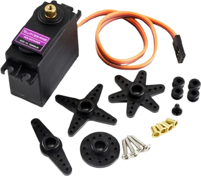
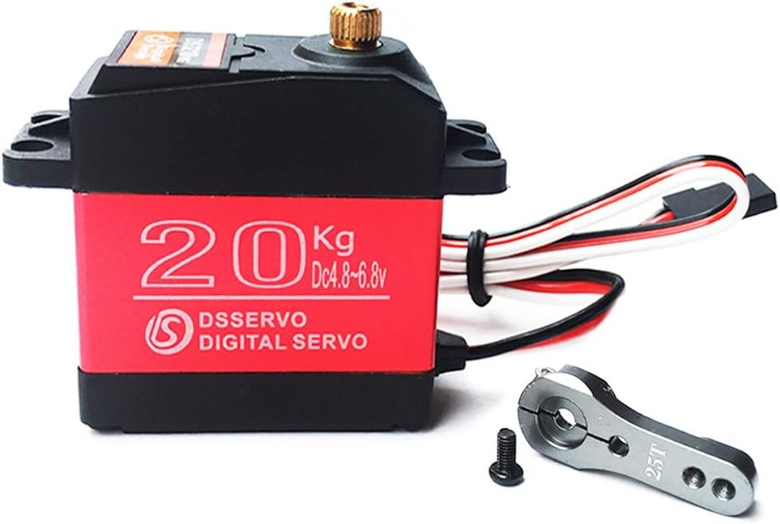
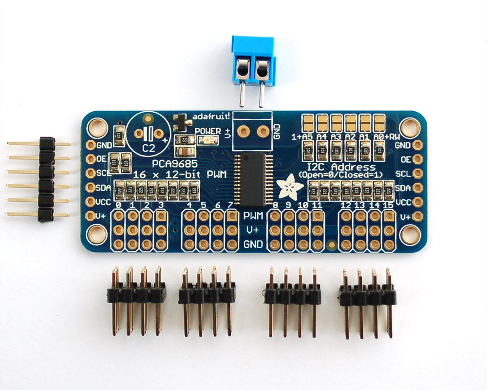
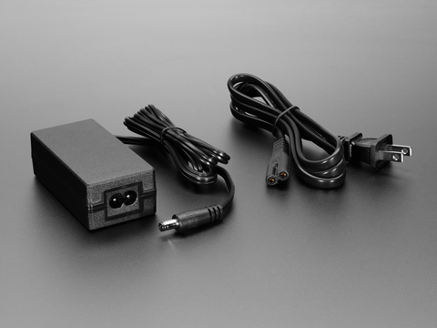
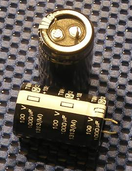
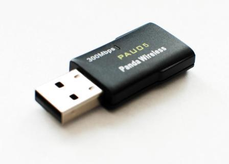
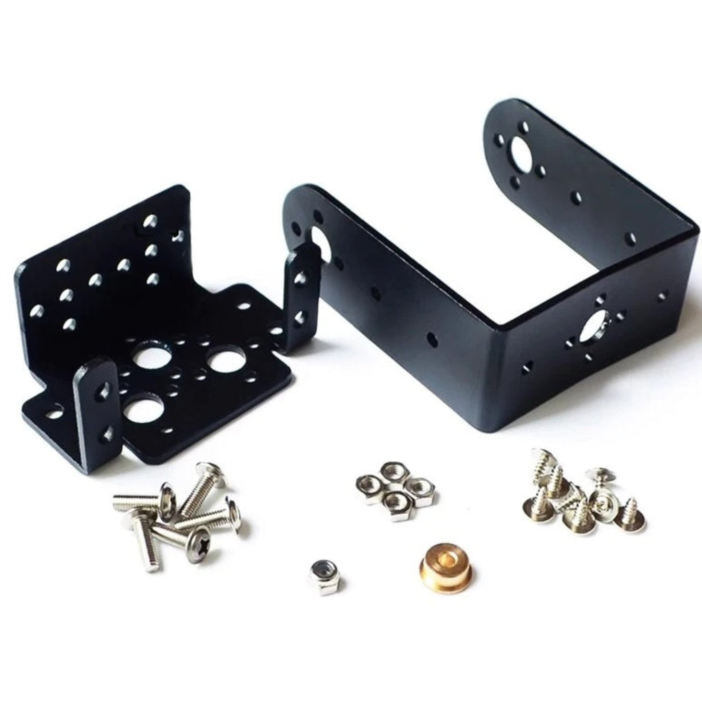
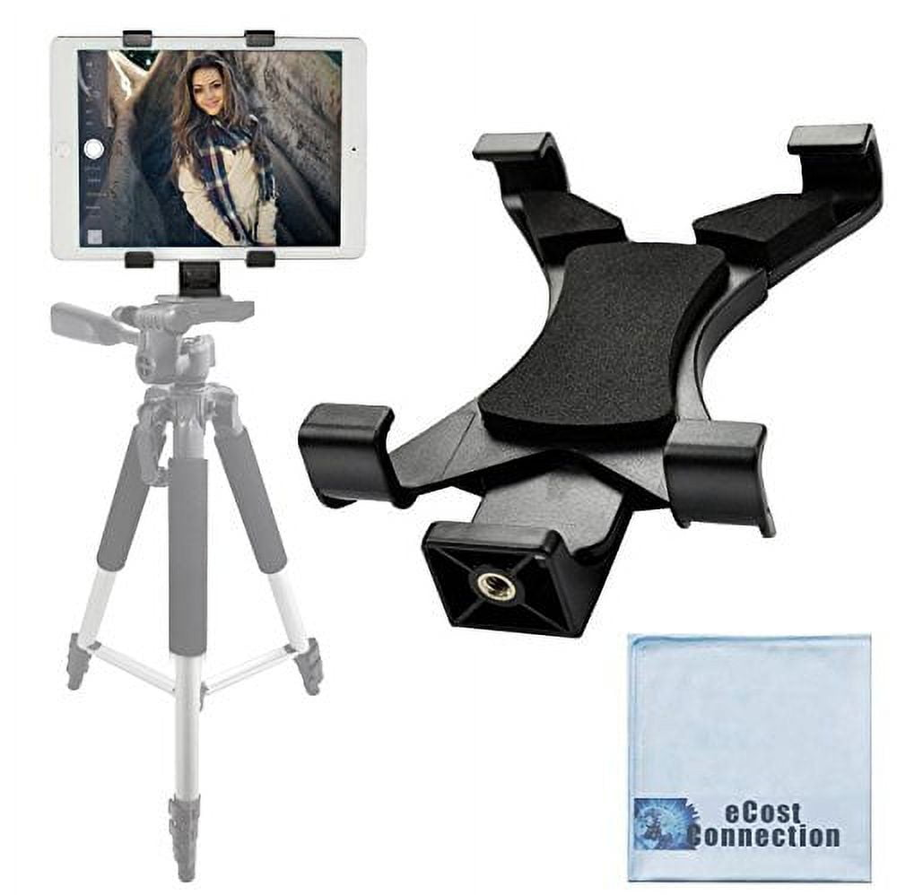
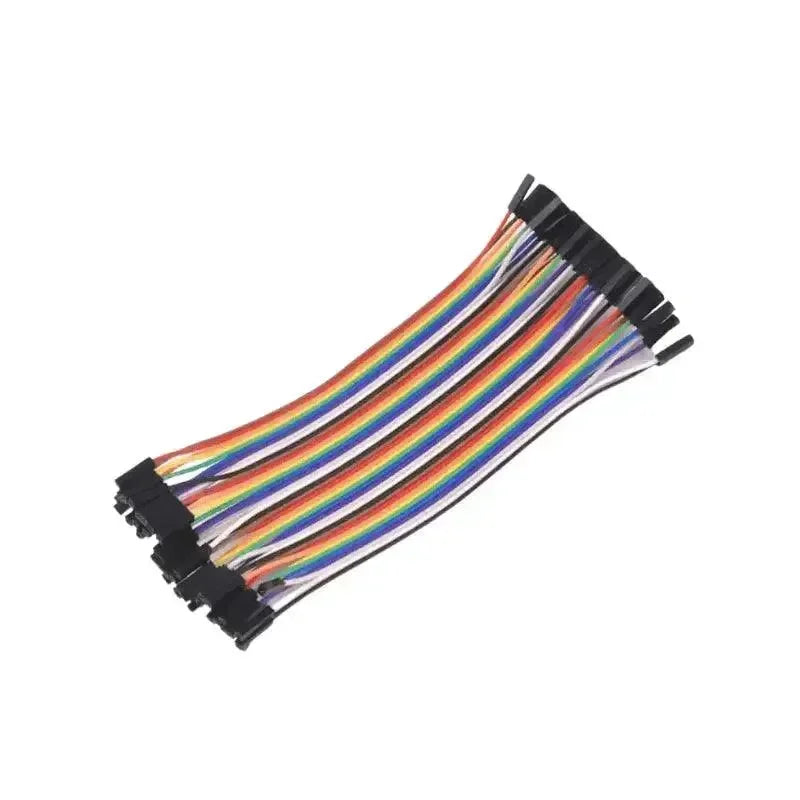

# BOM budget — tête 2 axes (pan + tilt), sans roll (cf. issue #10)

Version économique de [BOM.md](BOM.md) : regarder autour de soi demande
yaw + pitch uniquement ; le roll (penché latéral) est un luxe qu'on retire
avec tout ce qu'il entraînait. Vignettes cliquables = lien Amazon.ca.
Prix relevés le 21 nov. 2026, à confirmer au panier.

## Électronique

| Image | Pièce | Spec | Qté | Prix indicatif | Note |
|---|---|---|---|---|---|
|  | Servo Pan | MG996R, couple ~10 kg·cm, pignons métal | 1 | ~14 $ | Miuzei validé (180°, métal) ; 1 seul (pas de roll) |
|  | Servo Tilt | DS3218, couple ~20 kg·cm, pignons métal | 1 | 22,99 $ | Plus fort : il porte la tablette ; version 180° (pas 270°) |
|  | Contrôleur PWM | PCA9685 16 canaux, I2C | 1 | 15,98 $ | SDA/SCL/3.3V/GND vers le Pi |
| — | Raspberry Pi | Pi 1 Model B Rev 2 (vérifié, EN STOCK) | 1 | 0 (stock) | Serveur Go (#28), pas d'achat |
|  | Alim servos | 5 V / 4 A minimum, jack ou bornier | 1 | ~20 $ | Ligne séparée du Pi (jamais le 5V du Pi pour les servos) |
|  | Condensateur | 1000 µF / 10 V+ électrolytique à l'unité (magasin local) | 1 | ~3 $ | Sur V+ du PCA9685 ; pas besoin du kit de 240 |
|  | Dongle Wi-Fi USB | Chipset Ralink RT5370, 2,4 GHz | 1 | ~15 $ | Reconnu d'office ; robot mobile oblige |

## Mécanique

| Image | Pièce | Spec | Qté | Prix indicatif | Note |
|---|---|---|---|---|---|
| — | Base bois lestée | 20×20 cm, ép. ≥ 18 mm | 1 | récup/chute | Percer + visser le socle Pan ; lester si besoin |
|  | Kit pan-tilt 2 axes alu | Pour MG996R/DS3218, ex. short pan-tilt kit | 1 | ~15 $ | Base PAN→TILT + roulement ; visserie du kit réutilisée partout |
|  | Pince tablette | Pince universelle 8" (216×130 mm) | 1 | 12,79 $ | Fixation directe sur le tilt, coins dégagés ; ouverture ≥ 130 mm ; filetage 1/4" standard (prévoir vis 1/4" vers le support) |
|  | Câblage | Dupont femelle-femelle 20 cm | 1 lot | 10,99 $ | I2C Pi→PCA9685 ; alim : câble PSU coupé direct au bornier |

## Total indicatif (sans Pi ni tablette) : ~130 $CA (fourchette ~120–140)

## Ce qui change vs BOM complet (~110 $ économisés)

- Pas d'axe roll : −1 MG996R (~14 $) − équerre roll (~8–16 $).
- Palonniers alu : ceux du kit + le bras métal 25T inclus avec le DS3218 suffisent (à vérifier à réception) → −12 $.
- Visserie : visserie du kit + vis bois récup → pas de kit M3 → −17 $.
- Condo à l'unité en magasin (~3 $) au lieu du kit de 240 → −14 $.
- Pas de rallonges servo (le tilt est proche de la base ; à vérifier au montage) → −14 $.
- Pas d'adaptateur jack : câble d'alim coupé/étamé direct au bornier → −10 $.
- Pas de fil silicone : runs courts, câble PSU direct → −10 $.

## Impact logiciel (rien à coder côté tablette)

- Le serveur Go ignore le roll (clamp à 0 + log) : une ligne, protocole inchangé (champs optionnels).
- 6 gestes sur 10 n'utilisent jamais le roll (nod_yes, shake_no, greet_wake,
  sleepy_bow, listening, reset_neutral) : identiques.
- `tilt_curious`, `look_away_shy`, `confused_scan` : perdent la penchée latérale,
  gardent le mouvement principal ; `excited_wiggle` perd son trémoussement
  (piste : le convertir en oscillation yaw plus tard).

## Étapes (cf. issue #10)

1. Pi OS Lite + I2C, câblage PCA9685, alim + condo.
2. Neutre 90° des 2 servos (canaux 0/1) avant vissage.
3. Montage bois → kit pan-tilt → pince tablette directe sur tilt.
4. Bascule simu -> Pi via `HEAD_SIM_HOST`/`HEAD_SIM_PORT`.
5. Test stabilité élec puis grandeur nature.

## Sources des photos

Tinkered (MG996R), Adafruit et son Flickr (alim, PCA9685), boutiques
spécialisées (DS3218, kit, pince, dupont), Panda Wireless (dongle),
Wikimedia Commons (condo 1000 µF).
