# BOM — tête robotisée 3-DOF (d'après issue #10)

Prix indicatifs Amazon.ca, nov. 2026 — à vérifier au moment de commander.
Statut : à inventorier (cocher ce qui est déjà en stock).
Vignettes cliquables = lien d'achat Amazon.ca (ou recherche si pas de fiche).

## Électronique

| Image | Pièce | Spec | Qté | Prix indicatif | Note |
|---|---|---|---|---|---|
| <a href="https://www.amazon.ca/s?k=MG996R+servo+metal+180">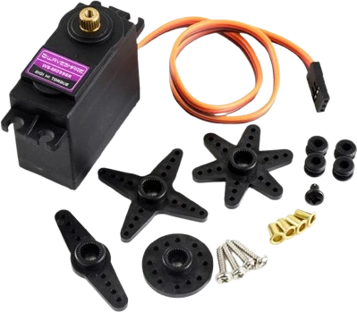</a> | Servo Pan + Roll | MG996R, couple ~10 kg·cm, pignons métal | 2 | ~14 $/pc | Miuzei validé (180°, métal) ; palonniers plastiques inclus ; prévoir palonniers alu 25T séparés |
| <a href="https://www.amazon.ca/dp/B0769DFJVK">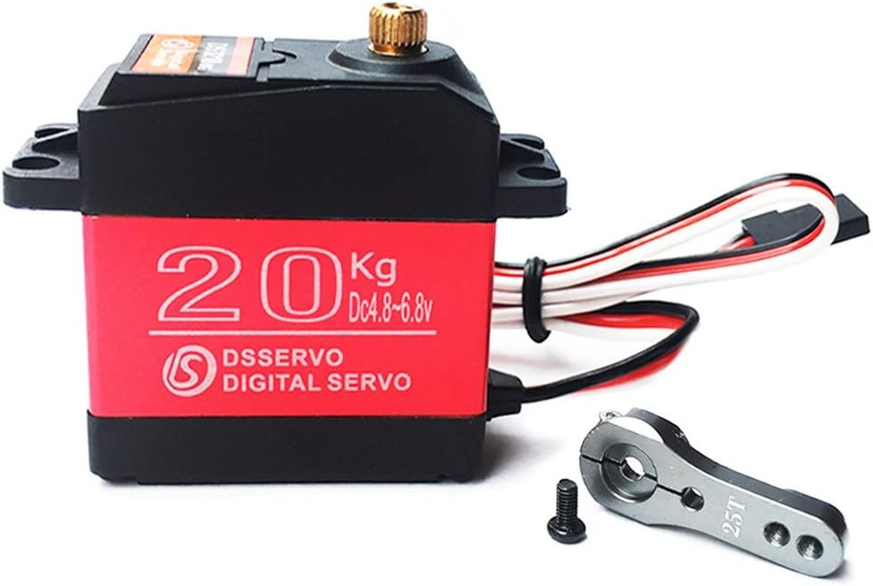</a> | Servo Tilt | DS3218, couple ~20 kg·cm, pignons métal | 1 | 22,99 $ | Plus fort : il porte la tablette en porte-à-faux ; prendre la version 180° (pas 270°) |
| <a href="https://www.amazon.ca/dp/B014KTSMLA">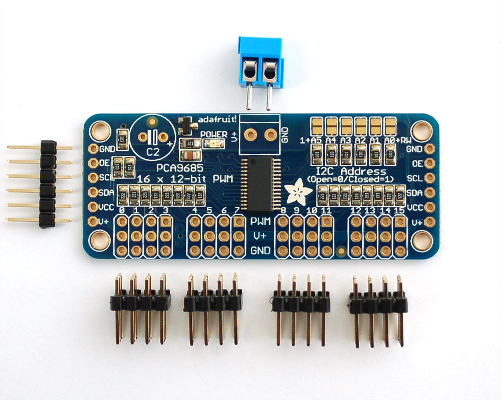</a> | Contrôleur PWM | PCA9685 16 canaux, I2C | 1 | 15,98 $ | SDA/SCL/3.3V/GND vers le Pi (SUNFOUNDER sur amazon.ca) |
| — | Raspberry Pi | Pi 1 Model B Rev 2 (vérifié, EN STOCK) | 1 | 0 (stock) | Serveur Go (#28), pas d'achat ; SD 4 Go serrée, 16 Go conseillées |
| <a href="https://www.amazon.ca/dp/B09JW28WQC">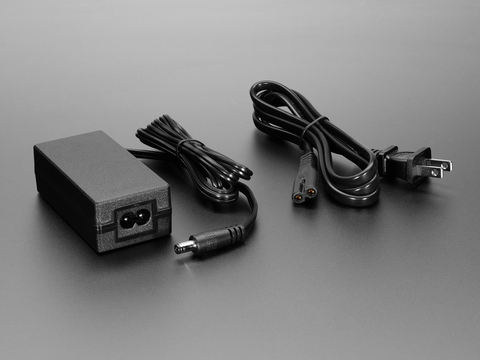</a> | Alim servos | 5 V / 4 A minimum, jack ou bornier | 1 | ~20 $ | Ligne séparée du Pi (jamais le 5V du Pi pour les servos) |
| <a href="https://www.amazon.ca/dp/B07KC99W2K">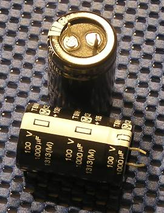</a> | Condensateur | 1000 µF / 10 V+ électrolytique (kit assortiment) | 1 lot | 16,99 $ | Sur V+ du PCA9685, anti-reset du Pi en pointe de courant (kit assortiment : le 1000 µF/16V est dedans) |
| <a href="https://www.amazon.ca/dp/B0946YMG2R">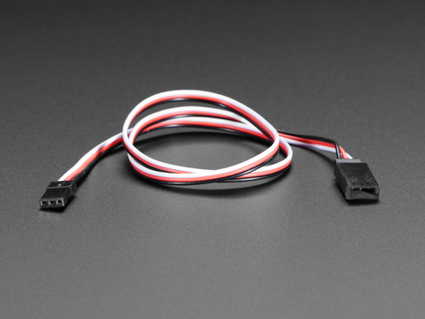</a> | Rallonges servo | JR mâle-femelle, assortiment 10–60 cm (JZK 25 pcs) | 1 lot | ~14 $ | 30 et 50 cm utiles (tilt/roll) ; connectique JR standard |
| <a href="https://www.amazon.ca/dp/B07MQTCZBG">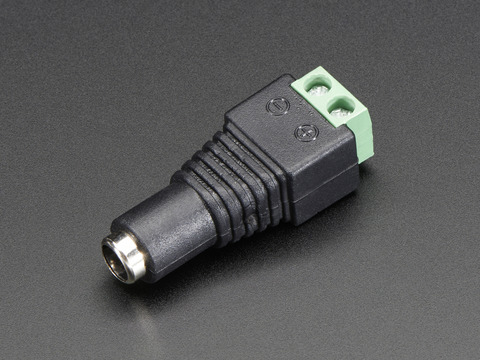</a> | Adaptateur jack→bornier | Femelle 5,5×2,1 vers bornier à vis (lot) | 1 lot | 10,60 $ | Relie l'alim au bornier V+ du PCA9685, sans soudure |
| <a href="https://www.amazon.ca/s?k=RT5370+wifi+dongle+raspberry+pi">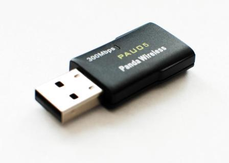</a> | Dongle Wi-Fi USB | Chipset Ralink RT5370 (ex. Panda PAU05), 2,4 GHz | 1 | ~15 $ | Reconnu d'office par Pi OS ; éviter TL-WN725N (loterie drivers) et AC600/1200 (DKMS) |

## Mécanique

| Image | Pièce | Spec | Qté | Prix indicatif | Note |
|---|---|---|---|---|---|
| — | Base bois lestée | 20×20 cm, ép. ≥ 18 mm | 1 | récup/chute | Percer + visser le socle Pan ; lester si besoin |
| <a href="https://www.amazon.ca/s?k=pan+tilt+servo+bracket+kit+MG996R">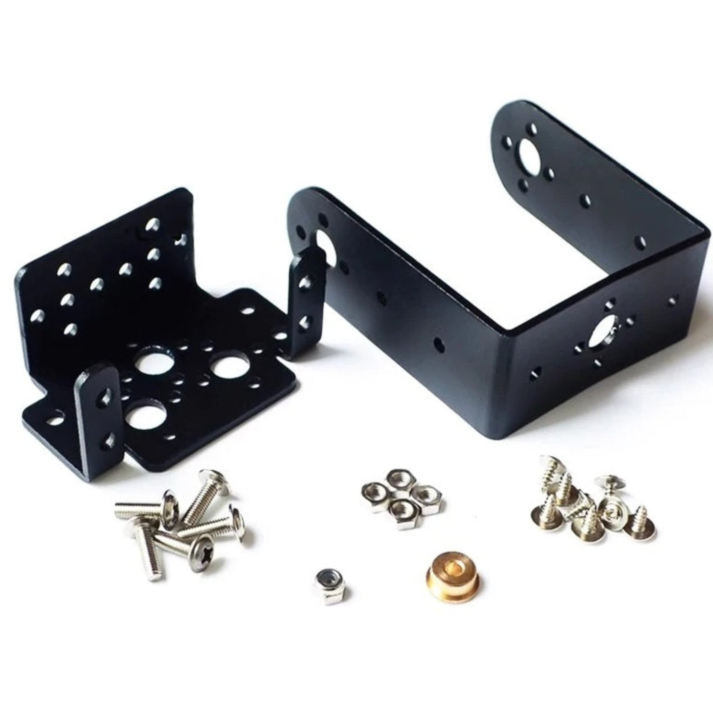</a> | Kit pan-tilt 2 axes alu (1× U court + 1× multifonction + roulement + visserie) | Pour MG996R/DS3218, ex. short pan-tilt kit | 1 | ~15 $ | Base PAN→TILT : palonnier vissé sous plateau, roulement sous charge (cf. hardware/plan-2d-v2.png) |
| <a href="https://www.amazon.ca/s?k=multifunction+servo+bracket+MG996R">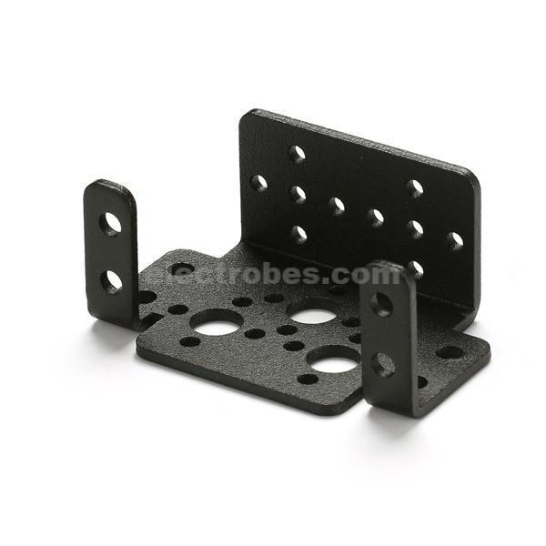</a> | Équerre multifonction alu (berceau standard 40×20) | Type servo bracket 58×37×25,5 | 1–2 | ~8 $/pc | Berceau ROLL + fixation tablette : servo bridé par oreilles, palonnier vissé |
| <a href="https://www.amazon.ca/s?k=25T+metal+servo+horn">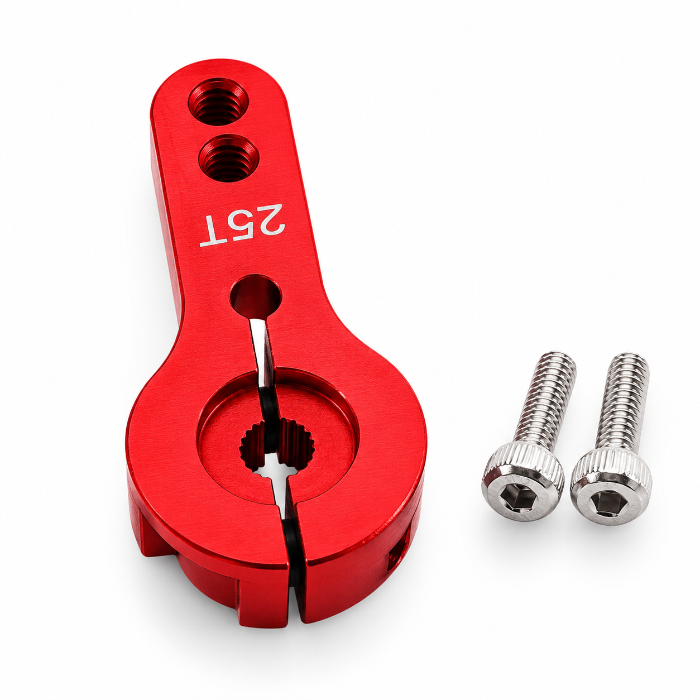</a> | Palonniers alu 25T | Bras métal 25 dents (MG996R/DS3218) | 3 | ~12 $/lot | Mise au neutre 90° avant vissage (cf. issue #10) ; le DS3218 inclut déjà un bras métal 25T |
| <a href="https://www.amazon.ca/dp/B01G934L2O">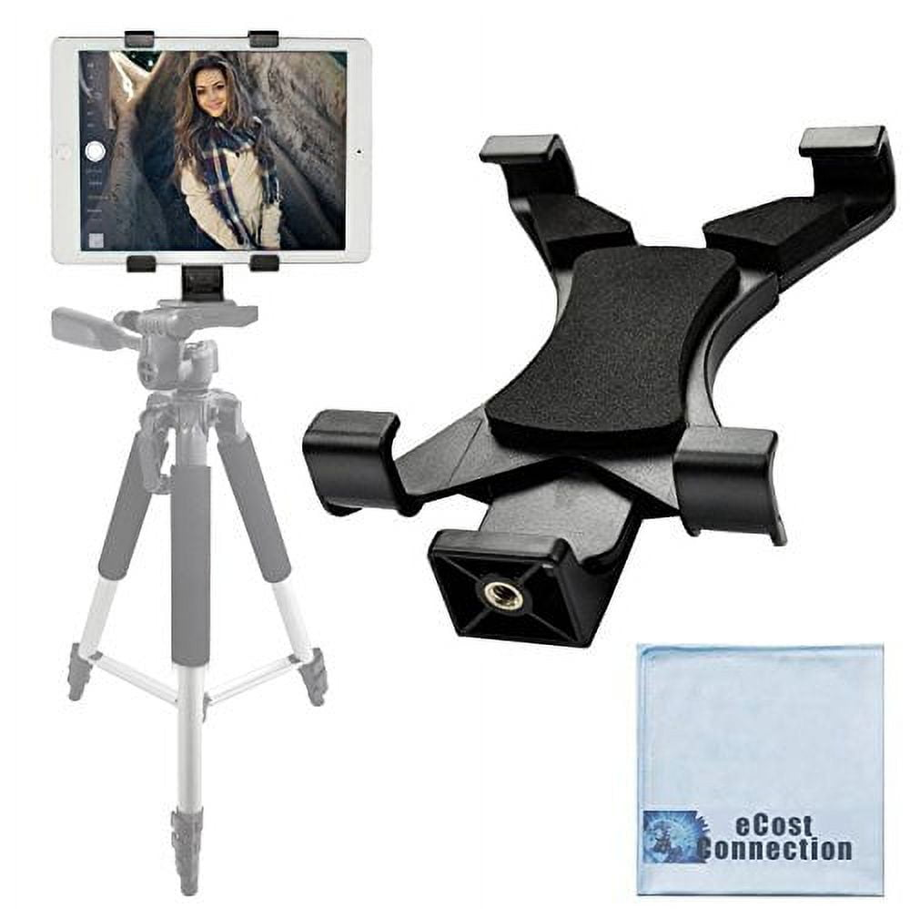</a> | Pince tablette | Pince universelle 8" (Dell Venue 8 Pro, 216×130 mm) | 1 | 12,79 $ | Fixation sur Roll, coins dégagés ; vérifier ouverture ≥ 130 mm ; filetage 1/4" standard (prévoir vis 1/4" vers le support) |
|  | Visserie | M3/M4 + écrous frein, entretoises laiton M3 | 1 lot | 17,36 $ | Kit assortiment 120 pcs |
| <a href="https://www.amazon.ca/dp/B01LZF1ZSZ">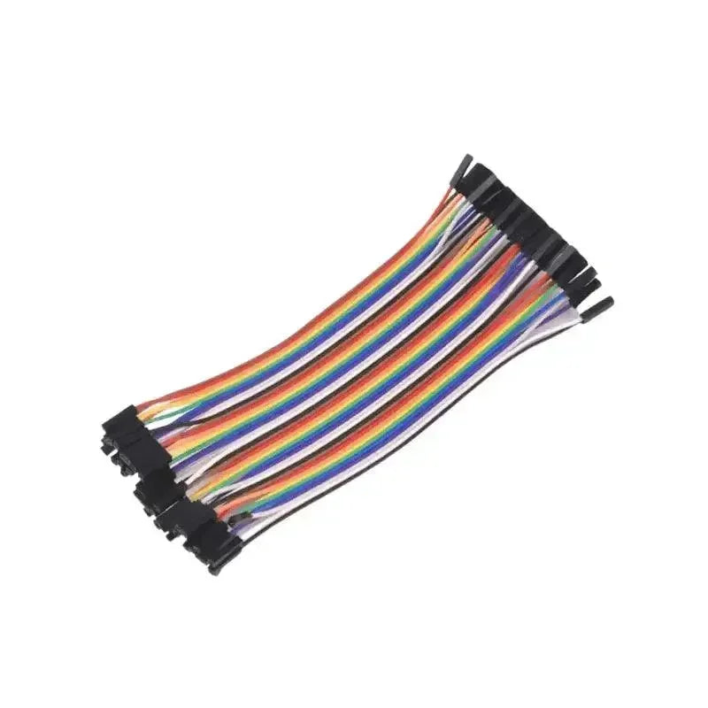</a> | Câblage | Dupont femelle-femelle 20 cm + fil silicone 18AWG (alim) | 1 lot | 10,99 $ + fil ~10 $ | Mou suffisant pour ±60° Pan, ±25° Tilt/Roll ; kit 120 pcs inclut le F-F 20 cm (fil silicone : prix à vérifier) |

## Total indicatif (sans Pi ni tablette) : ~240 $CA (fourchette ~220–250 selon options ; prix Amazon.ca relevés le 21 nov. 2026, à confirmer au panier)

## Étapes (cf. issue #10)

1. Pi OS Lite + I2C (`raspi-config`), câblage PCA9685, alim + condo.
2. Neutre 90° des 3 servos (canaux 0/1/2) avant vissage des palonniers.
3. Montage bois → équerres → pince tablette, câbles avec mou.
4. Bascule simu -> Pi via `HEAD_SIM_HOST`/`HEAD_SIM_PORT` (`127.0.0.1:9080` = simu Godot, IP du Pi ensuite).
5. Test stabilité élec (mouvements 3 axes combinés) puis grandeur nature.

## Sources des photos

Tinkered (MG996R), fabricants et revendeurs via leurs pages produits
(DS3218, kit, équerre, palonniers, pince, visserie, dupont), Adafruit
et son Flickr (alim, PCA9685, rallonges, adaptateur jack), Panda Wireless
(dongle), Wikimedia Commons (condo 1000 µF).
